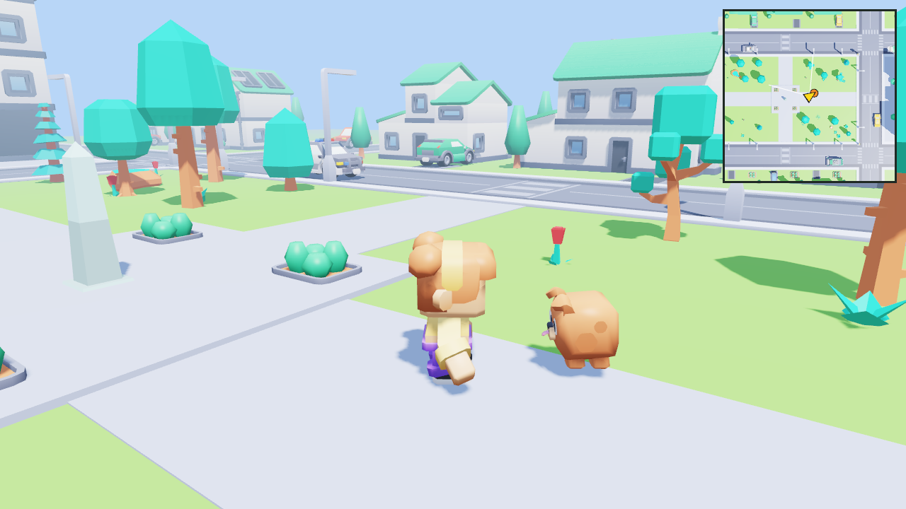
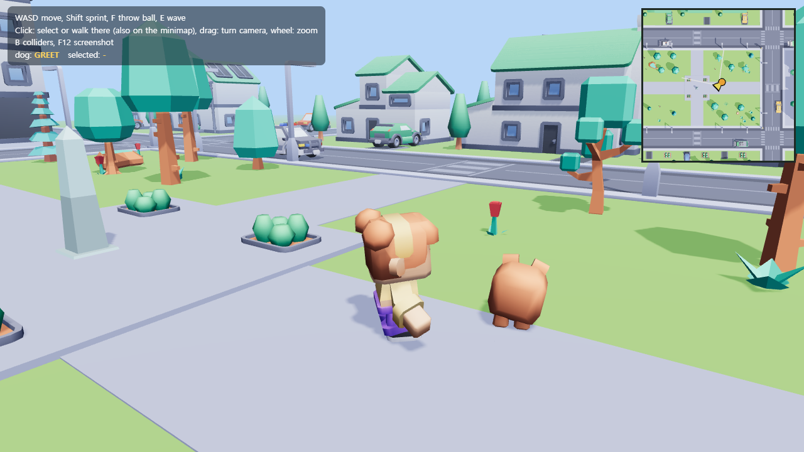

# P3 Starter Pack

P3에서 3D 작품을 만들 때 출발점으로 쓰는 팩입니다. 들어 있는 것:

- **에셋:** Kenney 키트 7개(모델 622개), HDRI 3장, PBR 텍스처 4세트, 효과음 22개(게임에 사용)와 효과음 라이브러리 489개(`assets/sounds/library/SOUNDS.md`)
- **실행되는 예제 장면:** 도로로 둘러싸인 공원, 양옆 주택가, 동서쪽 상점가가 있는 작은 마을입니다. 캐릭터를 움직이면 강아지가 다가와 반갑게 인사하고, 공을 던지면 물어 옵니다. 마우스로 물체를 고르거나 땅을 눌러 걸어갈 수 있고, 집과 나무에 부딪힙니다. 오른쪽 위에는 미니맵이 있습니다
- **두 가지 구현:** Python + OpenGL 트랙과 three.js(WebGL) 트랙. 둘 중 프로젝트에 맞는 쪽을 고르세요

| Python + PyOpenGL | three.js |
|---|---|
|  |  |

## 1. 트랙 고르기

두 트랙은 같은 `scene.json`을 읽고, 같은 기능과 같은 강아지 행동을 구현합니다. 중간에 트랙을 바꿔도 장면은 그대로 옮겨집니다.

| | Python + PyOpenGL (`python/`) | three.js (`web/`) |
|---|---|---|
| 렌더링 | 직접 작성한 GLSL 셰이더 (Blinn-Phong, shadow map, skinning) | three.js가 처리 (PBR, HDRI 환경광, 그림자) |
| 장점 | 파이프라인 전체가 내 코드. 수업에서 배운 알고리즘을 직접 구현하기 좋음 | 적은 코드로 보기 좋은 결과. 브라우저 링크로 바로 시연 |
| 이런 프로젝트에 | 셰이더 효과, 직접 만든 shadow/texture/BVH/CSG, 렌더링 기법 비교 | 상호작용이 많은 작품, 게임, 웹 전시, 많은 에셋과 애니메이션 |
| 필요한 것 | Python 3.10 이상, uv | 웹 브라우저, 로컬 서버(Python 하나면 됨), 인터넷(three.js를 CDN에서 받음) |

## 2. 실행

### Python 트랙

```bash
cd python
uv sync          # 처음 한 번: pygame-ce, PyOpenGL, numpy 설치
uv run python -m platformer
```

### 3D 인내의 숲 (플랫폼 게임)

로비 → 1스테이지 → 2스테이지 → 결과 → 로비·상점으로 이어지는 싱글플레이 게임입니다.
기존 **pygame-ce + PyOpenGL + NumPy** 엔진을 유지하며, Python 트랙의 공통 렌더러와
GLB 로더를 재사용합니다. 외부 모델·텍스처·음원 없이 기본 도형과 생성 효과음으로 실행됩니다.
기존 `main.py`의 마을 예제와 `web/` 트랙은 별도로 유지됩니다.

```powershell
cd python
uv sync
uv run python -m platformer
# 자동 테스트
uv run python -m unittest discover -s platformer -t . -v
```

Python 3.10 이상, OpenGL 3.3 지원 그래픽 환경이 필요합니다. 의존성은
`python/pyproject.toml`의 `pygame-ce>=2.5`, `PyOpenGL>=3.1.7`, `numpy>=1.26`입니다.
uv 없이 설치한다면 `python -m pip install pygame-ce PyOpenGL numpy` 후
`python -m platformer`로 실행할 수 있습니다 (`python/` 폴더 기준).

| 조작 | 동작 |
|---|---|
| WASD | 카메라 수평 방향 기준 이동, 대각선 속도 정규화 |
| Space | 새 입력에 한 번 점프 / 로프에서 놓고 점프 |
| 마우스·휠 | 3인칭 시점 회전·거리 조절, 지형에 맞춰 카메라 거리 보정 |
| E | 가까운 로프 잡기 |
| 로프에서 W/S | 오르내리기, 양 끝에서 정지 |
| Esc | 일시정지·커서 해제 / 일시정지에서 재개 |
| Tab·왼쪽 클릭 | 플레이 중 커서 해제·고정 / 다시 고정 |
| F3 | FPS·접지·수직 속도·상태·충돌체 디버그 표시 |

로비에는 도전·상점·조작법·설정·종료 버튼이 있습니다. 일시정지 화면에서도
재개·로비 복귀·설정·종료를 선택할 수 있습니다. 다른 창으로 전환하면 자동으로 일시정지합니다.

**코스와 게임 규칙**

- 1스테이지는 넓은 발판과 원숭이·왕복 장애물을 사용하는 입문 코스입니다.
- 2스테이지는 더 좁은 발판·원숭이·가시·로프를 조합합니다. 기본 점프만으로 통과하는
  주 경로와 로프·가시 도약을 사용할 수 있는 옆쪽 경로가 있습니다.
- 금빛 문 안에 착지하거나 걸어 들어가면 다음 스테이지 또는 결과 화면으로 넘어갑니다.
- 원숭이 머리 위의 노란 표시는 공격 예고입니다. 바나나는 발사 시점의 목표를 향한 탄도로
  움직이고, 지형 충돌·피격·수명 종료 시 제거됩니다. 동시에 최대 24개만 유지합니다.
- 피격은 짧은 수평 넉백·기절과 1초 무적을 적용합니다. 무적 중 중복 피격은 막고
  캐릭터 빛·깜박이는 외곽선으로 표시합니다. 가시는 더 큰 위쪽 충격을 추가합니다.
- 낙하는 현재 스테이지 시작점으로 복귀하며 속도·피격·무적·로프 상태를 초기화합니다.
  도전 시간은 계속 흐릅니다. 일시정지 중에는 시간·물리·투사체·음악을 함께 정지합니다.
- 2스테이지 완료 시 기본 100메소에 시간 보너스를 더합니다. 보너스는
  `max(0, 240 - 클리어 초) × 2`, 최대 총 보상은 600메소입니다. 도전 포기에는 보상이 없고
  한 도전에는 한 번만 지급합니다. 빠른 기록은 최고 기록으로 저장합니다.
- 상점의 모자 2개·색상 3개·등 장식 1개를 구매·장착·해제할 수 있습니다.
  잔액 부족·중복 구매를 막으며 같은 슬롯에는 하나만 장착합니다. 능력치는 바뀌지 않습니다.

**설정과 데이터 수정 위치**

| 파일 | 책임 |
|---|---|
| `platformer/game.py` | 창·메인 루프·입력·장면 연결 |
| `platformer/controller.py` | 이동·점프·고정 120Hz 물리·충돌·넉백·로프 상태 |
| `platformer/stages.py` | 두 코스, 도착 구역, 원숭이 주기·속도·사거리·방향, 가시·로프 |
| `platformer/level.py` | 기존 발판·왕복 장애물 데이터 (1스테이지 기반) |
| `platformer/world.py`, `hazards.py` | 원숭이·투사체·가시·로프·연속 충돌 검사 |
| `platformer/config.py` | 보상·투사체·가시 충격·로프 속도·기본 설정 |
| `platformer/progress.py`, `session.py` | 화면·도전 시간·보상·장면 수명 관리 |
| `platformer/inventory.py`, `save.py` | 치장·구매·장착·저장 검증 |
| `platformer/visuals.py`, `geometry.py` | 충돌과 분리된 모델·치장·기본 도형 |
| `platformer/resources.py`, `audio.py` | 모델·음원 로딩 및 대체 처리 |
| `platformer/ui.py`, `camera.py`, `input.py` | 한글 UI·카메라 충돌·마우스 |

기존 이동 테스트 장면은 `platformer/demo.py`에 보존했습니다.
이동 속도·점프 높이·최고점 시간·공중 조작·복귀 높이·넉백은 `MovementSettings`에서 조절합니다.
가시는 `config.py`의 `spike_impulse`, 로프는 `rope_speed`, 보상은 같은 파일의 `GameSettings`에서 조절합니다.
발판의 최소·최대 좌표는 X=좌우, Y=높이, Z=앞뒤이며, 발판 윗면은 최대 Y입니다.
기본 진행 방향은 -Z입니다. 코스를 수정하면 `stages.py`의 검증 경로 `route`도 함께 갱신하세요.

**저장과 폰트**

Windows 기본 저장 위치는 `%LOCALAPPDATA%/ForestOfPatience/save.json`, 그 밖의 환경은
`~/.local/share/ForestOfPatience/save.json`입니다. 리소스 폴더와 분리되어 있습니다.
버전·메소·보유·장착·최고 기록·BGM/SFX 볼륨·마우스 감도·그림자 설정을 저장합니다.
임시 파일에 기록·flush/fsync 후 교체하며, 손상된 파일은 가능한 경우
`save.corrupt-<시간>.json`으로 백업하고 기본값으로 시작합니다. UI에 복구·저장 실패 안내를 표시합니다.
테스트용 저장은 `--save 경로`로 분리할 수 있습니다.

한글은 `assets/font/Maplestory Light.ttf`를 본문에,
`assets/font/Maplestory Bold.ttf`를 제목과 큰 글씨에 우선 사용합니다.
메이플스토리 폰트가 없으면 Windows 맑은 고딕 또는 설치된 한글 시스템 폰트를 사용합니다.
`assets/fonts/NotoSansKR-Regular.ttf`를 제공해도 됩니다. 한글 폰트를 찾지 못하면
기본 폰트와 영문 메뉴·조작 안내로 전환합니다.

**GLB 모델·재질 교체**

`assets/platformer/models.example.json`을 `assets/platformer/models.json`으로 복사하면
포함된 캐릭터·절벽·나무 모델을 연결할 수 있습니다. JSON의 경로는 `assets/models/` 기준입니다.
사용 가능한 주요 역할은 `character`, `platform`, `monkey`, `banana`, `spike`, `rope`,
`obstacle`, `tree`, `hat`, `back`입니다. 예:

```json
{
  "character": "forest/character.glb",
  "platform": "forest/platform.glb",
  "monkey": "forest/monkey.glb",
  "banana": "forest/banana.glb"
}
```

Blender에서는 미터 단위, 적용된 회전·스케일, 캐릭터 발바닥 중앙 원점을 권장합니다.
Blender의 Z-up 장면을 glTF 내보내기로 변환하고 게임 좌표는 Y-up, 캐릭터 전방은 +Z로 맞춥니다.
glTF 2.0의 **GLB 형식**으로 내보내고 기본 색상용 PNG/JPEG를 포함하면 별도 변환 없이 읽습니다.
외부 텍스처를 쓰면 GLB가 참조하는 상대 경로를 유지하세요. 모델은 지정한 시각 크기에 맞춰
축별로 스케일하므로 원형 비율을 유지하려면 `visuals.py`의 지정 크기도 모델에 맞추세요.
캐릭터의 `idle`, `walk`, `jump` 클립이 있으면 상태에 맞춰 재생합니다.

기본 색상·텍스처와 금속성·거칠기 **상수 값**을 읽어 기존 Blinn–Phong 조명에 근사 적용합니다.
방향광·환경광·그림자를 사용합니다. 완전한 PBR, 노멀맵·금속성/거칠기 텍스처,
투명 재질, 압축 GLB 확장, morph target은 구현 범위에 포함하지 않습니다.
스킨은 최대 32관절입니다. 모델 로딩 실패는 기본 도형으로, 누락된 텍스처는 흰 텍스처와
기본 색상으로 대체하고 원인을 로그에 남깁니다. 시각 모델과 충돌체는 별개입니다.

**음원 교체**

아래 파일을 제공하면 사용합니다. 제공되지 않은 음원은 다운로드하지 않습니다.

```text
assets/audio/platformer/
  lobby.ogg          # 로비 (같은 이름의 .wav/.mp3도 검색)
  stage1.ogg         # 1스테이지
  stage2.ogg         # 2스테이지
  jump.wav          # 점프
  land.wav          # 착지
  hit.wav           # 피격
  purchase.wav      # 구매
  clear.wav         # 클리어
  throw.wav         # 던지기
  respawn.wav       # 낙하 복귀
```

`assets/sounds/WhenTheMorningComes.mp3`를 기본 공통 배경음악으로 반복 재생합니다.
로비·스테이지 전환 시 같은 곡은 처음부터 다시 시작하지 않으며 일시정지·볼륨 설정을 따릅니다.
위 경로에 장면별 음원이 있으면 해당 장면에서는 그것을 우선 사용합니다.
사용자가 제공한 다른 음원도 위 이름으로 배치할 수 있습니다. BGM이 없으면 무음,
효과음이 없으면 짧은 생성음을 사용합니다. 오디오 장치가 없어도 게임은 계속 실행됩니다.
볼륨은 설정에서 BGM·효과음을 따로 조절하고 저장합니다.

**검증과 웹 실행 범위**

자동 테스트 61개로 기존 이동·점프·착지·옆면/머리 충돌·저프레임·낙하 복귀에 더해
원숭이 예고·탄도·투사체 제한/제거·피격/무적·가시 도약·로프·카메라 충돌·두 코스 도달,
일시정지·보상 중복 방지·구매·슬롯 교체·저장 복원/손상 복구·리소스 대체·오디오 전환을 검증했습니다.
30FPS 입력 시뮬레이션으로 실제 장애물을 포함한 두 코스를 연속 클리어하는 통합 테스트도 통과합니다.
실제 OpenGL 숨김 창에서 외부 아트 없이 **439프레임, 14.62초 클리어, 550메소 지급·저장**을 확인했고,
로비·상점·설정·플레이·결과 화면 및 실제 GLB 교체·누락 모델 대체의 화면을 확인했습니다.
사람의 키보드·마우스 직접 플레이 감각과 음원 청음은 검증하지 않았습니다.

```powershell
# python/에서 실행: 별도 저장 파일을 사용하는 재현 가능한 자동 클리어
uv run python -m platformer --hidden --autoplay --fps 0 --frames 1500 --save platformer/test-output/check.json --screenshot platformer/test-output/results.png
# 낮은 실제 렌더 FPS로 플레이 / 외부 리소스 없는 대체 경로
uv run python -m platformer --play --fps 5
uv run python -m platformer --resources platformer/test-output/empty-assets
```

이 게임의 **웹 버전은 구현·검증하지 않았습니다.** 현재 데스크톱 pygame/OpenGL 루프를
브라우저에서 실행하는 경로는 없습니다. 저장소의 기존 `web/`는 마을 예제입니다.
웹 게임으로 제공하려면 기존 three.js 트랙에 스테이지 데이터를 JSON으로 공유하고,
고정 물리·게임 상태·원숭이/투사체·로프·상점/UI를 이식하며, 저장은 localStorage,
입력은 Pointer Lock, 오디오는 브라우저 재생 허용 흐름으로 연결해야 합니다.
별도 웹 포팅·브라우저 검증 작업이 필요합니다.

### three.js 트랙

브라우저는 보안 때문에 `file://`로 연 페이지에서 모델 파일을 읽지 못합니다. 그래서 로컬 서버가 필요합니다.

```bash
# P3-Starter-Pack 폴더(이 README가 있는 곳)에서
python -m http.server 8000
```

브라우저에서 http://localhost:8000/web/ 을 엽니다. VS Code Live Server를 써도 됩니다. 이때도 서버의 루트는 `P3-Starter-Pack` 폴더여야 합니다(`web/`은 `../assets`, `../scene.json`을 읽습니다).

### 조작 (두 트랙 같음)

| 키 | 동작 |
|---|---|
| W A S D | 이동 (카메라 기준 방향) |
| Shift | 달리기 |
| F | 공 던지기 (카메라가 보는 쪽으로) |
| E | 손 흔들기 |
| 마우스 왼쪽 클릭 | 물체 선택(노랗게 빛남), 땅이나 미니맵을 누르면 그곳으로 걸어감 |
| 마우스 왼쪽 드래그 | 카메라 회전 |
| 휠 | 확대, 축소 |
| B | 충돌 영역(collider) 보기 |
| M | 소리 끄기, 켜기 |
| F12 | 스크린샷 |
| Esc | 종료 (Python) |

## 3. 기본으로 구현된 것

- **glTF(GLB) 불러오기:** 노드 계층, base color(색 값과 텍스처). Python 트랙은 `gltf.py`에 로더를 직접 구현했습니다(외부 라이브러리 없음).
- **애니메이션:** 노드 TRS keyframe 보간(위치, 크기는 선형, 회전은 slerp), 동작 사이 cross-fade
- **GPU skinning:** 사람 캐릭터는 skinned mesh입니다(관절 7개). 강아지는 부위별 rigid 애니메이션입니다.
- **조명:** 태양(directional light), 거리 안개, ACES tone mapping. 주변광은 Python 트랙이 하늘과 땅 색의 hemisphere ambient와 Blinn-Phong, three.js 트랙이 HDRI 환경광과 PBR(MeshStandardMaterial)
- **그림자:** 플레이어를 따라다니는 shadow map(2048²). Python 트랙은 3×3 PCF를 셰이더에 직접 구현, three.js 트랙은 PCFSoftShadowMap
- **3인칭 카메라:** 플레이어를 부드럽게 따라가는 orbit 카메라
- **충돌:** 집, 차, 울타리는 AABB를 바닥에 투영한 사각형, 나무는 줄기 크기의 원. 캐릭터(원)를 밀어내는 방식이라 벽을 따라 미끄러집니다(`physics.py` `push_out`, `physics.js` `pushOut`). 꽃, 풀, 길처럼 낮은 물체는 막지 않습니다.
- **공:** 중력과 semi-implicit Euler 적분, 땅과 벽에서 튀기(반발 계수), 굴러가며 느려지기(마찰)
- **마우스 picking:** 화면 좌표에서 카메라 ray를 만들고 모든 물체의 AABB와 slab 방법으로 교차 검사. 가장 가까운 물체를 고르고, 땅이 더 가까우면 그 점으로 걸어갑니다(클릭 이동). 벽에 막혀 0.6초 동안 못 가면 멈춥니다.
- **미니맵 HUD:** 위에서 내려다보는 직교 카메라로 장면을 한 번 더 그려 오른쪽 위 viewport(240×240 px, 가로세로 48 m)에 넣습니다. `glViewport`와 `glScissor`(three.js는 `setViewport`, `setScissor`)로 그리는 영역을 제한하고, 북쪽이 위입니다. 노란 화살표는 플레이어, 흰 선은 카메라 시야, 주황 점은 강아지, 빨간 점은 공, 초록 고리는 클릭 이동 목표입니다. Python 트랙은 지도 안에 걸치는 물체만 그리고(AABB culling), three.js는 frustum culling이 자동입니다.
- **효과음:** 발소리(잔디와 포장도로를 구별), 공 던지기, 공 튀기기(땅, 벽), 강아지 짖기, 선택과 이동 클릭. 소리마다 세계 좌표가 있어 거리에 따라 작아지고(inverse 거리 모델) 좌우로 나뉩니다(equal-power panning). 귀는 캐릭터 머리에 두고 카메라 방향으로 돌립니다. 소리 목록과 음량은 `assets/sounds/sounds.json`.
- **강아지 행동:** 아래 상태 기계

### 강아지 상태 기계 (`python/actors.py`, `web/actors.js`)

```
WANDER ──플레이어가 6 m 안──▶ NOTICE ──0.5초──▶ APPROACH ──1.5 m까지 접근──▶ GREET ──2.6초──▶ FOLLOW
  ▲  (집 주변 산책)          (멈춰서 쳐다봄)      (달려옴)                (깡충 3번, 춤추며 한 바퀴)   (졸졸 따라옴)
  │                                                                                              │
  └────────────────────────── 플레이어가 11 m 넘게 멀어짐 (Shift로 달려 따돌리기) ───────────────────┘

공을 던지면 (어느 상태에서든, 플레이어가 11 m 안에 있으면)
  CHASE ──공이 멈추고 입이 닿음──▶ RETURN ──플레이어 앞 1.5 m──▶ DROP ──1초──▶ FOLLOW
  (공을 쫓아 달림)                 (입에 물고 달려옴)              (내려놓고 꼬리 흔들기)
```

- 반경과 속도는 `Dog` 클래스 맨 위 상수입니다. 바꿔 가며 느낌을 조절해 보세요.
- 이벤트는 observer 패턴으로 연결합니다. 강아지가 인사를 시작하면 `on_greet`(JS는 `onGreet`), 플레이어가 공을 던지면 `on_throw`(`onThrow`)에 등록된 함수가 불립니다. 예제는 이것으로 플레이어가 손을 흔들게 하고, 강아지가 공을 쫓게 합니다.
- 효과음도 같은 방식입니다. `on_step`, `on_hit`(공), `on_bark`에 소리를 내는 함수를 등록했을 뿐이라, 게임 코드는 소리를 모릅니다. 새 소리를 붙이려면 이벤트에 함수 하나를 더 등록하면 됩니다.
- 한 번 인사한 뒤에는 따라다니기만 합니다. 멀리 떠났다가 다시 오면 또 인사합니다.

## 4. 장면 바꾸기: `scene.json`

```jsonc
{
  "kitScale": { "mini-characters": 2.2, "cube-pets": 0.55, "city-kit-suburban": 6.0, "car-kit": 1.4,
                "nature-kit": 3.0, "city-kit-roads": 8.0, "city-kit-commercial": 8.0 },
  "ground": { "size": 160, "color": "#7cb85a" },          // 색은 sRGB hex
  "sun": { "direction": [-0.45, -1.0, -0.35], "color": [1.0, 0.95, 0.85], "intensity": 2.0 },
  "player": { "model": "mini-characters/character-female-b.glb", "pos": [0, 0, 6], "rotY": 0 },
  "dog": { "model": "cube-pets/animal-dog.glb", "pos": [10, 0, -6], "home": [10, 0, -6], "wanderRadius": 4 },
  "props": [
    { "model": "city-kit-roads/road-straight.glb", "pos": [-8, -0.08, -16], "rotY": 0 },
    { "model": "city-kit-suburban/building-type-a.glb", "pos": [-48, 0, -27], "rotY": 0 },
    { "model": "nature-kit/tree_oak.glb", "pos": [12, 0, 3], "rotY": 40, "scale": 1.1 }
  ]
}
```

- 단위는 미터, y가 위쪽입니다. `rotY`는 y축 회전(도), `scale`은 키트 배율에 곱해집니다.
- 모델 경로는 `assets/models/` 아래 상대 경로입니다. 각 키트의 `Preview.png`에서 모델을 고르세요.
- **마을 격자:** 도로 타일 한 장이 8 m입니다. 타일 중심을 8의 배수 좌표에 두면 이어집니다. 차도 높이를 땅과 맞추려고 도로 타일은 `y = -0.08`에 둡니다(인도는 8 cm 높게 올라옵니다). `road-straight`는 `rotY` 0이면 동서 방향, 90이면 남북 방향입니다.
- **충돌 규칙:** 길, 타일처럼 낮은 것은 막지 않고, 나무, 가로등, 표지판, 파라솔은 줄기나 기둥만 막습니다(`physics.py`의 `SKIP`, `POLES`).
- **다른 장면 파일:** `CG_SCENE=my_scene.json uv run main.py`, 웹은 `?scene=my_scene.json`. 팩 폴더 기준 경로입니다.
- 캐릭터는 `mini-characters/character-*.glb` 20명 중에서, 강아지 자리에는 `cube-pets/animal-*.glb` 24종 중 아무거나 넣을 수 있습니다(애니메이션 이름이 같습니다).

## 5. 코드 구조

### `python/`

| 파일 | 내용 |
|---|---|
| `main.py` | 창, 입력, 게임 루프 |
| `gltf.py` | GLB 파서, 노드 계층, skin, 애니메이션 샘플링과 cross-fade (GL 코드 없음) |
| `renderer.py` | OpenGL 3.3 core: VAO 업로드, 셰이더, shadow map, AABB 선 그리기 |
| `scene.py` | `scene.json` 읽기, `Instance`(위치, 회전, 크기, AABB), collider 만들기, 코드로 만든 바닥과 공 |
| `physics.py` | 충돌(원 밀어내기), 공 물리, 마우스 ray와 AABB, 땅 교차 |
| `minimap.py` | 미니맵: 두 번째 카메라, viewport와 scissor, 아이콘, 지도 클릭 |
| `sound.py` | 효과음: pygame.mixer, 거리 감쇠, 좌우 패닝, 녹화용 믹스 |
| `camera.py` | perspective, look-at, ortho 행렬과 3인칭 카메라 |
| `actors.py` | `Player`, `Dog` (상태 기계) |

### `web/`

| 파일 | 내용 |
|---|---|
| `index.html` | import map(three.js 0.170.0), 화면 안내 |
| `main.js` | 렌더러, 조명, HDRI, 모델 배치, 카메라, 입력, picking, 루프 |
| `actors.js` | `Animator`(AnimationMixer 감싸기), `Player`, `Dog` |
| `physics.js` | `physics.py`와 같은 충돌, 공, picking |
| `minimap.js` | `minimap.py`와 같은 미니맵. 아이콘은 layer 1에 두어 미니맵 카메라만 그림 |
| `sound.js` | `sound.py`와 같은 효과음. `THREE.AudioListener`, `THREE.PositionalAudio`. 브라우저는 첫 클릭이나 키 입력 뒤에 소리를 켭니다 |

### 시연 각본 `docs/demo.json`

시간별 동작 목록입니다. 두 트랙 모두 이 각본을 재생할 수 있습니다. 같은 입력에 대한 결과를 비교하거나 시연 영상을 만들 때 씁니다.

- Python: `CG_DEMO=../docs/demo.json uv run main.py` (Windows PowerShell은 `$env:CG_DEMO="../docs/demo.json"; uv run main.py`). `CG_REC=demo.mp4`를 더하면 ffmpeg로 영상을 저장합니다.
- three.js: http://localhost:8000/web/?demo=../docs/demo.json

## 6. 확장 아이디어 (수업 내용과 연결)

| 주제 | 해 볼 만한 것 |
|---|---|
| 텍스처 (W99 Texture Mapping) | `assets/textures`의 PBR 세트로 바닥에 albedo, normal, roughness 입히기. tangent space normal map 직접 구현 |
| 조명과 재질 (W12) | 낮과 밤 전환, 가로등 point light 여러 개, HDRI 바꾸기, cascaded shadow map |
| 가시성과 BVH (W10, W11) | AABB로 view frustum culling, 마우스 클릭 picking(ray와 AABB 교차), BVH로 가속 |
| 게임 패턴 (W13) | 강아지 여러 마리, 쓰다듬기(근접 트리거), 겁 많은 고양이(같은 상태 기계로 반대 행동), 꽃 모으기와 점수, 저장과 불러오기 |
| CSG와 SDF (W14) | SDF로 만든 오브젝트를 장면에 섞기, 레이마칭 하늘이나 물 |
| 애니메이션 | 발이 땅에 맞는 걸음(속도와 동작 재생 속도 맞추기), 점프와 중력, 자동차 운전(`drive` 동작, 바퀴 노드 회전) |
| 충돌과 길 찾기 | 회전된 물체의 OBB 충돌, 공과 캐릭터의 충돌, 클릭 이동에 A* 길 찾기(지금은 직선으로 가다 막히면 멈춤) |
| 소리 | 배경 소리(새, 바람, 차 소리)를 구역별로, 강아지 발소리, 소리가 벽에 가려지면 작아지기(ray로 가림 검사), 도플러 효과 |
| 미니맵 | 카메라 방향으로 돌아가는 지도, 원형 마스크, 확대와 축소, 지나간 길 표시, 안개 낀 미탐험 지역 |
| 선택 | AABB 대신 삼각형 단위 ray 교차(정확한 picking), 선택한 물체 드래그로 옮기기, 장면 편집기 |

## 7. 알아 둘 점

- **Python 트랙 성능:** 물체가 아주 많아지면 Python의 draw call 비용이 커집니다. 같은 모델을 많이 쓰면 instancing(`glDrawElementsInstanced`)을 해 보세요. GL 오류를 추적할 때는 `main.py` 위쪽의 `OpenGL.ERROR_CHECKING`을 `True`로 바꾸세요(대신 느려집니다).
- **Python 트랙 재질:** base color만 씁니다. normal, roughness 맵은 확장 과제로 남겨 두었습니다.
- **three.js 트랙:** 같은 skinned 캐릭터를 여러 번 배치할 때는 `SkeletonUtils.clone`을 써야 합니다(예제 `place()`가 이미 그렇게 합니다).
- **에셋 라이선스:** `ASSETS.md`를 보세요. 코드로 만든 던지기 소리 두 개(earshot, MIT)를 빼면 모두 CC0입니다.
